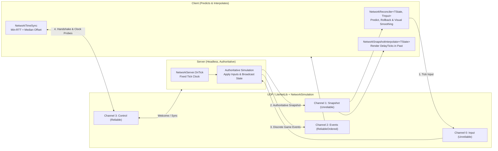

<div align="center">


# Krut.Netcode

**Deterministic, zero-allocation, Native-AOT authoritative-server netcode for .NET 9 on LiteNetLib.**

[](https://github.com/Cedsson/Krut.Netcode/actions/workflows/ci.yml)
[](https://www.nuget.org/packages/Krut.Netcode)
[](https://www.nuget.org/packages/Krut.Netcode)
[](https://dotnet.microsoft.com/)
[](LICENSE)

[Quick Start](#quick-start) • [Architecture](#architecture) • [Prediction & Interpolation](#client-prediction--interpolation) • [Link Simulator](#network-link-simulator) • [Benchmarks](#benchmarks) • [Documentation](#documentation)

</div>

---

## Overview

**Krut.Netcode** is a lightweight, engine-agnostic multiplayer networking library built on top of [LiteNetLib](https://github.com/RevenantX/LiteNetLib) and `System.Numerics`. Extracted from the dedicated server and client engine of *Krut.Racing*, it provides the core primitives needed for fast-paced, authoritative-server multiplayer games without tying you to a specific game engine, scene graph, or reflection-heavy serializer.

### Key Capabilities

| Area | What Krut.Netcode Provides |
| :--- | :--- |
| **Session & Handshake** | `NetworkServer` and `NetworkClient` with application ID, protocol version, sanitized player names, custom `ConnectionApproval`, explicit rejection reasons, and library-managed auto-reconnect. |
| **Zero-Allocation Messaging** | Static per-type pools (`NetworkMessagePool<T>`), single-pass `Broadcast` serialization, `ArrayPool<byte>` receive buffers, and explicit `NetDataWriter`/`NetDataReader` codecs (`0 B` allocated per packet in steady state). |
| **Native-AOT Ready** | Zero runtime reflection, zero dynamic code generation, and zero attribute scanning. Verified in CI with `PublishAot=true` and trim/AOT warnings treated as errors. |
| **Fixed-Tick Clock & Time Sync** | Frame-rate-independent `NetworkClock` with catch-up clamping, plus NTP-style `NetworkTimeSync` using minimum-RTT filtering and a rolling median offset. |
| **Client Prediction & Replay** | `NetworkReconciler<TState, TInput>` with ring-buffered input history, authoritative rollback/replay, and exponential/ease-out visual error smoothing with teleport thresholds. |
| **Snapshot Interpolation** | `NetworkSnapshotInterpolator<TState>` for remote entities with sub-tick rendering, bounded dead-reckoning extrapolation, and SIMD-accelerated component blending (`NetworkStateBlend`). |
| **Deterministic Link Simulator** | Built-in `NetworkSimulation` (latency, jitter, Gilbert–Elliott burst loss, packet reorder, duplication, token-bucket bandwidth cap, and scheduled blackouts) at message or raw datagram level. |
| **Hardened Wire Codec** | 16-bit quantized 3D positions and unit quaternions, non-finite (`NaN`/`Infinity`) sanitization, UTF-16 surrogate-safe truncation, control/Bidi-override stripping, and strict packet-length validation. |

---

## Installation

Install from [NuGet](https://www.nuget.org/packages/Krut.Netcode):

```bash
dotnet add package Krut.Netcode
```

---

## Architecture

Everything runs on the thread that calls `session.Update(deltaSeconds)` — no background callbacks into game logic and no locks required in user code.



---

## Quick Start

### 1. Define and Register a Game Message

Game messages claim a stable wire byte in `16..255` (`1..15` are reserved for built-in protocol messages) and serialize fields explicitly in matching order:

```csharp
using Krut.Netcode;
using LiteNetLib.Utils;

public sealed class CarInputMessage : INetworkMessage
{
    public const byte Wire = 16;

    public NetworkMessageType Type => NetworkMessageType.None;
    public byte WireType => Wire;
    public NetworkDelivery Delivery => NetworkDelivery.Unreliable;
    public byte Channel => NetworkChannels.Input;

    public int Tick;
    public float Throttle;
    public float Steer;

    public void Reset()
    {
        Tick = 0;
        Throttle = 0f;
        Steer = 0f;
    }

    public void Write(NetDataWriter writer)
    {
        writer.Put(Tick);
        writer.Put(Throttle);
        writer.Put(Steer);
    }

    public void Read(NetDataReader reader)
    {
        Tick = reader.GetInt();
        Throttle = reader.GetFloat();
        Steer = reader.GetFloat();
    }
}

// Register once at startup (shared across sessions in the same process):
NetworkMessages.RegisterGameMessage<CarInputMessage>(CarInputMessage.Wire, NetworkDelivery.Unreliable);
```

### 2. Run the Server and Client Loop

```csharp
var config = new NetworkConfig
{
    ApplicationId = "my.game",
    ProtocolVersion = 1,
    Port = 25555,
    TickRate = 60, // Match your fixed physics timestep
    MaxClients = 16,
};

using var server = new NetworkServer(config);
server.MessageReceived += envelope =>
{
    if (envelope.Is<CarInputMessage>(out var input))
    {
        // Apply input for envelope.PeerId; envelope.Message is recycled when this handler returns.
    }
};
server.Start();

using var client = new NetworkClient(config);
client.SessionReady += () => Console.WriteLine($"Ready as peer #{client.LocalPeerId} @ {client.Config.TickRate} Hz");
client.Closed += (reason, text) => Console.WriteLine($"Disconnected ({reason}): {text}");
client.Connect("127.0.0.1", config.Port, playerName: "Alice");

// Main loop: call Update(dt) once per frame
while (running)
{
    server.Update(dt);
    client.Update(dt);

    if (client.IsSessionReady)
    {
        var msg = NetworkSession.Rent<CarInputMessage>();
        msg.Tick = client.CurrentTick;
        msg.Throttle = 1.0f;
        msg.Steer = -0.25f;
        client.Send(client.ServerPeerId, msg); // Automatically recycled after Send
    }
}
```

---

## Client Prediction & Interpolation

The lag-compensation primitives in `Prediction/` and `Time/` are completely decoupled from sockets and sessions. They operate over any `unmanaged` state/input structs with zero per-frame allocations:

```csharp
// 1. Local entity: predict immediately, rewind & replay unacknowledged inputs on server snapshot
var reconciler = new NetworkReconciler<UnitState, UnitInput>(VisualSmoothingSettings.Default)
{
    Step = UnitSim.Step,          // Pure function: (state, tick, input) -> nextState
    DistanceMetric = UnitSim.Distance,
};

// Each client tick:
UnitState predicted = reconciler.Predict(client.CurrentTick, localInput);

// When an authoritative snapshot arrives from the server:
if (reconciler.SetAuthoritativeState(snapshot.ServerTick, snapshot.OwnState))
{
    reconciler.Reconcile(snapshot.ServerTick, snapshot.LastProcessedInputTick,
        static (authState, ackTick, inputs, count) =>
        {
            var s = authState;
            for (int i = 0; i < count; i++)
                s = UnitSim.Step(s, ackTick + 1 + i, inputs[i]);
            return s;
        });
}

// Each render frame: advance visual error decay and render SmoothedState
reconciler.UpdateRenderState(frameDeltaSeconds);
RenderLocalUnit(reconciler.SmoothedState);

// 2. Remote entities: buffer snapshots and sample DelayTicks in the past
var interpolator = new NetworkSnapshotInterpolator<UnitState>(delayTicks: 3);
interpolator.Push(snapshot.ServerTick, snapshot.RemoteState);

double renderTick = client.CurrentTick + client.TickProgress - interpolator.DelayTicks;
if (interpolator.TrySampleTime(renderTick, out UnitState remoteState, out NetworkSampleMode mode))
{
    RenderRemoteUnit(remoteState);
}
```

---

## Network Link Simulator

Because LiteNetLib strips its internal debug simulator from Release NuGet builds, **Krut.Netcode** ships a deterministic, seeded link simulator that works in **all** build configurations. Configure it in code or via environment variables:

```bash
# Apply a named profile ("clean", "lan", "gate", "stress", "bad", "blackout", "thin")
export KRUT_NET_PROFILE=gate
export KRUT_NET_SEED=42
```

| Environment Variable | Description |
| :--- | :--- |
| `KRUT_NET_PROFILE` | Named preset in round-trip terms: `clean` (0 ms), `lan` (2 ms), `gate` (100 ms, 2% loss), `stress` (180 ms, 2% loss), `bad` (250 ms, 5% burst loss, reorder & dup), `blackout` (scheduled outages), `thin` (64 kbit/s downlink cap). |
| `KRUT_NET_LAG_MS` | Round-trip latency in ms (split equally per direction when resolved by side). |
| `KRUT_NET_JITTER_MS` | Round-trip latency variation ($\pm$ ms). |
| `KRUT_NET_LOSS` | Packet drop probability (`0.0` to `1.0`). |
| `KRUT_NET_BURST` | Mean burst loss length in messages (Gilbert–Elliott 2-state Markov model). |
| `KRUT_NET_REORDER` / `KRUT_NET_DUP` | Message reorder probability and duplication probability (`0.0` to `1.0`). |
| `KRUT_NET_BW_KBIT` | Token-bucket server downlink bandwidth cap in kbit/s with tail-drop queue. |
| `KRUT_NET_OUTAGES` | Comma-separated `start:duration` blackout windows in seconds (e.g. `15:1,30:5`). |
| `KRUT_NET_DATAGRAM` | `1` or `true` moves loss, bursts, and outages to the raw LiteNetLib UDP datagram layer (`NetworkDatagramSimLayer`). |

---

## Headless Prediction Demo

Run the self-contained headless verification harness (`samples/PredictionDemo`) simulating a server and two clients over localhost UDP with a degraded link:

```bash
dotnet run --project samples/PredictionDemo -c Release -- --profile gate --seconds 10
```

```text
Link: gate, 100 ms RTT +/-10, 2 % loss per direction
Running 10 s of play ...

                                                client 0    client 1
measured RTT, min / max (ms)                     124/156     124/156
clock lead (ticks)                                     8           8
packets dropped by link, up / down (%)           1.4/1.5     2.2/1.5
inputs repeated / late at server                    10/0        11/0

error vs server, no reconcile: mean (mm)            16.4        11.1
error vs server, no reconcile: max (mm)             30.4        18.0
error vs server, reconciled: mean (mm)               0.1         0.1
error vs server, reconciled: max (mm)                1.4         2.3

snapshots reconciled (rollbacks)                     299         290
inputs replayed, total / per rollback             2808/9     3048/10
rollback misses / ignored snapshots                  0/0         0/0

PASS: prediction stays close to the server, replay corrects the rest.
```

---

## Benchmarks

Measured with [BenchmarkDotNet](https://benchmarkdotnet.org/) on .NET 9 (`benchmarks/Krut.Netcode.Benchmarks`):

```bash
dotnet run -c Release --project benchmarks/Krut.Netcode.Benchmarks -- --filter "*"
```

| Benchmark | Mean Time | Allocated |
| :--- | ---: | ---: |
| `CodecBenchmarks.WritePositionAndRotation` | ~29 ns | `0 B` |
| `CodecBenchmarks.ReadPositionAndRotation` | ~23 ns | `0 B` |
| `MessagePoolBenchmarks.RentWriteReadRecycle` | ~38 ns | `0 B` |
| `InterpolatorBenchmarks.SampleOnly` | ~28 ns | `0 B` |
| `ReconcilerBenchmarks.PredictAndReconcile` (6 ticks / 100 ms RTT) | ~277 ns | `0 B` |
| `ReconcilerBenchmarks.PredictAndReconcile` (18 ticks / 300 ms RTT) | ~866 ns | `0 B` |

---

## Repository Layout & Documentation

```text
Krut.Netcode/
├── src/Krut.Netcode/                  # Core library (net9.0, IsAotCompatible)
│   ├── Session/                       # NetworkSession, NetworkServer, NetworkClient, NetworkConfig
│   ├── Messages/                      # INetworkMessage, NetworkMessages, NetworkCodec, NetworkProtocol
│   ├── Time/                          # NetworkClock, NetworkTimeSync
│   ├── Prediction/                    # NetworkReconciler, NetworkSnapshotInterpolator, NetworkStateRing
│   ├── Simulation/                    # NetworkSimulation, NetworkLinkModel, NetworkDelayQueue, Datagram layers
│   └── Diagnostics/                   # NetworkStatistics, NetDatagramProbe
├── tests/Krut.Netcode.Tests/          # xUnit test suite (handshake, codec, zero-alloc, security, simulator)
├── benchmarks/Krut.Netcode.Benchmarks/# BenchmarkDotNet throughput & memory benchmarks
├── samples/PredictionDemo/            # Headless server + 2 clients verification harness
└── docs/                              # In-depth user guide, maintainer architecture & Mermaid diagrams
```

- **[User Guide (`docs/guide.md`)](docs/guide.md)** — Configuration, message contracts, channels, prediction/interpolation setup, troubleshooting, and release workflow.
- **[Architecture (`docs/architecture.md`)](docs/architecture.md)** — Frame execution order, threading model, wire layout, and core invariants.
- **[Diagrams (`docs/diagrams.md`)](docs/diagrams.md)** — Mermaid sequence and component diagrams (with editable source in [`docs/architecture.drawio`](docs/architecture.drawio)).
- **[Roadmap (`docs/roadmap.md`)](docs/roadmap.md)** — Known design trade-offs and planned enhancements.
- **[Contributing (`CONTRIBUTING.md`)](CONTRIBUTING.md)** & **[Security Policy (`SECURITY.md`)](SECURITY.md)**.

---

## License

Licensed under the [MIT License](LICENSE). Copyright © 2026 William Eklund.
