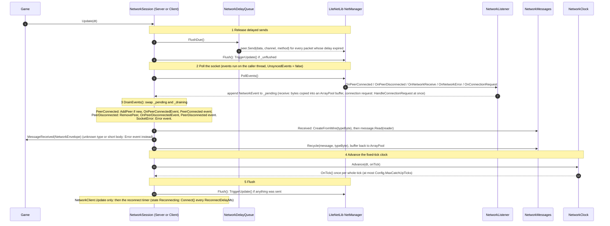
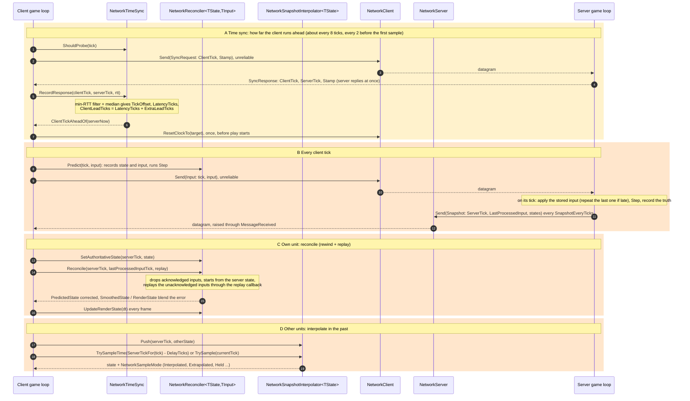
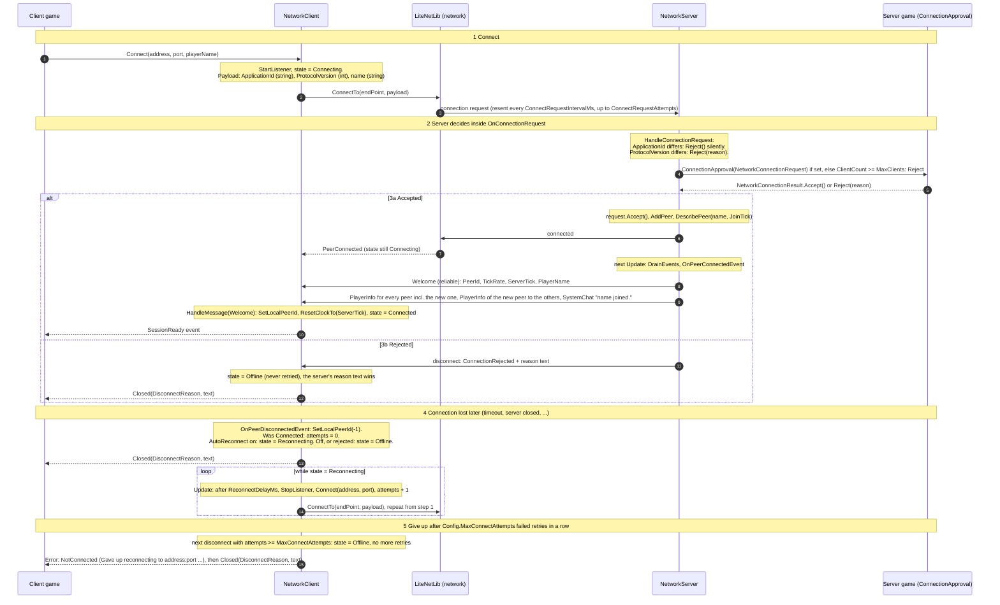
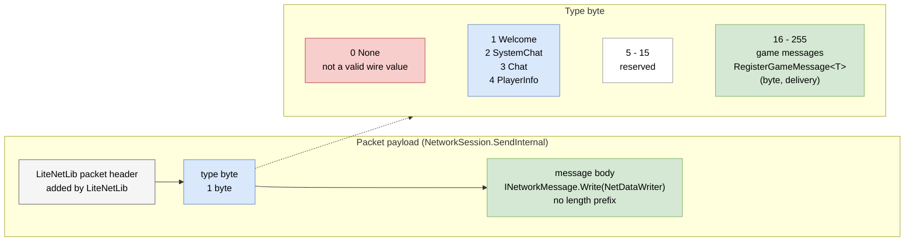

# Architecture diagrams

These are the same five diagrams as the pages of [architecture.drawio](architecture.drawio), written as Mermaid so GitHub renders them directly. The editable source is `architecture.drawio` (open it with [diagrams.net](https://app.diagrams.net) or the VS Code Draw.io extension); keep both in step when you change the code.

The groups follow the folders under `src/Krut.Netcode`: `Session/`, `Messages/`, `Time/`, `Prediction/`, `Simulation/`, `Diagnostics/`.

- [Overview](#overview)
- [Frame](#frame)
- [Prediction](#prediction)
- [Handshake](#handshake)
- [Wire format](#wire-format)

## Overview

Arrows mean "uses / calls / creates". A hollow arrowhead means "derives from". Dotted arrows are configuration or callbacks. Only the main dependencies are drawn (`NetworkError` and `NetworkSimRandom` are left out).

```mermaid
flowchart TB
    Game["Game code<br/>owns a NetworkServer or NetworkClient,<br/>calls Update(dt), registers and handles messages"]
    Game2["Game code (prediction loop)<br/>Predict, Reconcile, Push,<br/>TrySampleTime, RecordResponse"]
    LNL["LiteNetLib<br/>NetManager, INetEventListener,<br/>PacketLayerBase, ConnectionRequest"]

    subgraph Session["Session/ - transport and session"]
        direction TB
        NetworkServer["NetworkServer<br/>lobby, approval, Welcome + PlayerInfo"]
        NetworkClient["NetworkClient<br/>state machine, reconnect, SessionReady"]
        NetworkConnection["NetworkConnectionRequest<br/>NetworkConnectionResult"]
        NetworkSession["NetworkSession<br/>update loop, send/receive, peer table, events"]
        NetworkListener["NetworkListener<br/>internal INetEventListener,<br/>queues NetworkEvent"]
        NetworkPeerState["NetworkPeerState<br/>one per connected peer"]
        NetworkConfig["NetworkConfig<br/>tick rate, ports, timeouts, DatagramLayer"]
    end

    subgraph Messages["Messages/ - messages and wire"]
        direction TB
        NetworkMessages["NetworkMessages<br/>type registry + NetworkMessagePool#lt;T#gt;"]
        INetworkMessage["INetworkMessage<br/>Type, WireType, Delivery, Write, Read"]
        NetworkProtocol["NetworkProtocol.cs<br/>NetworkDelivery, NetworkChannels,<br/>NetworkMessageType"]
        NetworkCodec["NetworkCodec<br/>name, text, vector, quaternion encoding"]
        NetworkEnvelope["NetworkEnvelope<br/>PeerId, Message, Delivery, Time"]
    end

    subgraph Time["Time/"]
        direction TB
        NetworkClock["NetworkClock<br/>fixed tick accumulator"]
        NetworkTimeSync["NetworkTimeSync<br/>offset, RTT, client lead"]
    end

    subgraph Prediction["Prediction/ - lag primitives (game-driven)"]
        direction TB
        NetworkReconciler["NetworkReconciler#lt;TState,TInput#gt;<br/>rewind + replay, visual smoothing"]
        NetworkSnapshotInterpolator["NetworkSnapshotInterpolator#lt;TState#gt;<br/>render in the past"]
        NetworkStateRing["NetworkStateRing#lt;TEntry#gt;<br/>NetworkStateBlend, NetworkStateEntry#lt;T#gt;"]
    end

    subgraph Simulation["Simulation/ - link simulation"]
        direction TB
        NetworkSimulationProfile["NetworkSimulationProfile<br/>named presets"]
        NetworkSimulationOptions["NetworkSimulationOptions<br/>NetworkOutage"]
        NetworkSimulation["NetworkSimulation<br/>latency, jitter, loss, outages"]
        KrutEnv["KrutEnv<br/>KRUT_* environment variables"]
        NetworkSimulationStats["NetworkSimulationStats"]
        NetworkDelayQueue["NetworkDelayQueue<br/>internal, delays Send"]
        NetworkLinkModel["NetworkLinkModel<br/>per-link verdict"]
        NetworkDatagramChain["NetworkDatagramChain<br/>ordered PacketLayerBase list"]
        NetworkDatagramSimLayer["NetworkDatagramSimLayer<br/>datagram-level loss"]
    end

    subgraph Diagnostics["Diagnostics/"]
        direction TB
        NetworkStatistics["NetworkStatistics<br/>NetManager counters"]
        NetDatagramProbe["NetDatagramProbe<br/>byte / datagram counters (a PacketLayerBase)"]
    end

    NetworkServer -- derives --> NetworkSession
    NetworkClient -- derives --> NetworkSession
    NetworkServer -- approval --> NetworkConnection
    NetworkServer -- SanitizeName --> NetworkCodec
    NetworkSession <-- owns / receives events --> NetworkListener
    NetworkSession -- peer table --> NetworkPeerState
    NetworkSession -- reads --> NetworkConfig
    NetworkSession <-- NetManager --> LNL
    LNL -. callbacks .-> NetworkListener

    NetworkSession -- CreateFromWire, Recycle --> NetworkMessages
    NetworkSession -- raises MessageReceived --> NetworkEnvelope
    NetworkMessages -- creates, pools --> INetworkMessage
    NetworkMessages -- built-ins use --> NetworkCodec
    INetworkMessage -- Type, Delivery --> NetworkProtocol
    NetworkEnvelope -- wraps --> INetworkMessage

    NetworkSession -- Advance, ResetClockTo --> NetworkClock
    NetworkSession -- owns --> NetworkDelayQueue
    NetworkSession -- ApplySimulation --> NetworkSimulation
    NetworkSession -- DatagramChain --> NetworkDatagramChain
    NetworkSession -- Statistics --> NetworkStatistics
    NetworkConfig -. DatagramLayer .-> NetworkDatagramChain

    NetworkSimulationProfile -- ToOptions --> NetworkSimulationOptions
    NetworkSimulationOptions -- Create --> NetworkSimulation
    KrutEnv -- FromEnvironment --> NetworkSimulation
    NetworkSimulation -- configures --> NetworkLinkModel
    NetworkDelayQueue -- Submit --> NetworkLinkModel
    NetworkDelayQueue -- counts --> NetworkSimulationStats
    NetworkDatagramChain -- hosts --> NetworkDatagramSimLayer
    NetworkDatagramSimLayer -- Submit --> NetworkLinkModel

    NetworkSnapshotInterpolator -- buffer --> NetworkStateRing
    NetworkReconciler -- history --> NetworkStateRing

    Game -- Update, Send --> NetworkServer
    Game -- Update, Send --> NetworkClient
    Game -- RegisterGameMessage --> NetworkMessages
    Game2 --> NetworkReconciler
    Game2 --> NetworkSnapshotInterpolator
    Game2 --> NetworkTimeSync

    classDef session fill:#dae8fc,stroke:#6c8ebf,color:#000;
    classDef msg fill:#d5e8d4,stroke:#82b366,color:#000;
    classDef time fill:#fff2cc,stroke:#d6b656,color:#000;
    classDef lag fill:#ffe6cc,stroke:#d79b00,color:#000;
    classDef sim fill:#e1d5e7,stroke:#9673a6,color:#000;
    classDef ext fill:#f5f5f5,stroke:#666,color:#000;
    class NetworkServer,NetworkClient,NetworkConnection,NetworkSession,NetworkListener,NetworkPeerState,NetworkConfig session;
    class NetworkMessages,INetworkMessage,NetworkProtocol,NetworkCodec,NetworkEnvelope msg;
    class NetworkClock,NetworkTimeSync time;
    class NetworkReconciler,NetworkSnapshotInterpolator,NetworkStateRing lag;
    class NetworkSimulationProfile,NetworkSimulationOptions,NetworkSimulation,KrutEnv,NetworkSimulationStats,NetworkDelayQueue,NetworkLinkModel,NetworkDatagramChain,NetworkDatagramSimLayer,NetworkStatistics,NetDatagramProbe sim;
    class Game,Game2,LNL ext;
```

Colours: blue `Session/`, green `Messages/`, yellow `Time/`, orange `Prediction/`, purple `Simulation/` and `Diagnostics/`, grey external code.

## Frame

What `NetworkSession.Update(dt)` does, in order. `NetworkClient.Update` calls it first and then runs the reconnect timer.

## Prediction

The client and server loop per tick. Message bytes 16-19 below are the ones the `PredictionDemo` sample registers; a game registers its own.

## Handshake

Connect, approval, `Welcome`, `SessionReady`, reject and reconnect.

## Wire format

One message is one LiteNetLib packet payload: a type byte followed by the message body.

The receiver calls `NetworkMessages.CreateFromWire(typeByte)`, then `Read(reader)`. An unknown byte raises an `UnknownMessageType` error and keeps the connection; a body that is too short raises `MalformedMessage`. An unreliable message larger than the MTU raises `PacketTooLarge`.

### Message bodies

Fields appear in `Write` order. `int` and `float` are 4 bytes, `long` is 8 bytes, `string` is length-prefixed UTF-8 (names at most 32 characters, text at most 512).

| Byte | Message | Delivery | Body |
|---|---|---|---|
| 1 | `WelcomeMessage` | ReliableOrdered | `int PeerId`, `int TickRate`, `int ServerTick`, `string PlayerName` |
| 2 | `SystemChatMessage` | ReliableOrdered | `string Text` |
| 3 | `ChatMessage` | ReliableOrdered | `string Text` |
| 4 | `PlayerInfoMessage` | ReliableOrdered | `int PeerId`, `int JoinTick`, `string PlayerName` |
| 16 | PredictionDemo `InputMessage` | Unreliable | `int Tick`, `float Ax`, `float Ay` |
| 17 | PredictionDemo `SnapshotMessage` | Unreliable | `int ServerTick`, `int LastProcessedInput`, `UnitState Own`, `UnitState Other` (4 floats each) |
| 18 | PredictionDemo `SyncRequestMessage` | Unreliable | `int ClientTick`, `long Stamp` |
| 19 | PredictionDemo `SyncResponseMessage` | Unreliable | `int ClientTick`, `int ServerTick`, `long Stamp` |

The connection request carries a raw payload that is not a message: `string ApplicationId`, `int ProtocolVersion`, `string name`. It is read in `NetworkServer.HandleConnectionRequest`.

### Channels

`NetManager.ChannelsCount` is `NetworkChannels.Count` (4). `NetworkChannels.For` only ever returns channel 1 or 2, so channels 0 and 3 are reserved constants today. Delayed sends from `NetworkDelayQueue` use the same channel and method.

| Channel | Name | `NetworkDelivery` routed here | LiteNetLib `DeliveryMethod` | Used for |
|---|---|---|---|---|
| 0 | Input | none (constant only) | - | reserved |
| 1 | Snapshot | Unreliable | Unreliable | every unreliable message (input, snapshots, time sync in the sample) |
| 2 | Events | ReliableOrdered, ReliableUnordered | ReliableOrdered / ReliableUnordered | built-in messages and reliable game messages |
| 3 | Control | none (constant only) | - | reserved |
